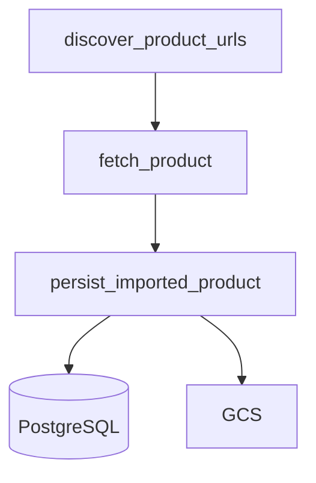

# Scraping masivo por proveedor

Documento de referencia para migrar la ingesta masiva desde el scraper Selenium legacy hacia el runner HTTP basado en `provider_importers`.

Cuaderno de trabajo diario: [`../scraping-migracion-notas.md`](../scraping-migracion-notas.md).

## Objetivo

Reemplazar [`scraper_locas/`](../../scraper_locas/) (Selenium + proxy Ford + cortes hardcode) por un runner HTTP reutilizable que:

1. Descubra URLs de producto en listados paginados.
2. Importe cada ficha con `fetch_product()` del registry.
3. Persista con la misma lógica que el admin (`services/provider_import.py`).

Proveedores en el runner: **Las Locas**, **Nissie Denim**, **HOLIC** y **So Chic**. El registro operativo está en [`provider_importers/bulk/brands.json`](../../provider_importers/bulk/brands.json) (`python -m provider_importers.bulk.runner --list-brands`).

## Estado legacy (`scraper_locas/`)

| Limitación | Detalle |
|------------|---------|
| Motor | Selenium + ChromeDriver + proxy `internet.ford.com:83` |
| Alcance | Solo `productos/denim` |
| Cortes | `self.pages = 2` y máximo 4 fichas por página ([`Locas.py`](../../scraper_locas/Locas.py)) |
| Persistencia | Insert directo en `Products` sin variantes, colores ni categoría |
| Imágenes | Descarga local + subida GCS desde disco |
| Disparo | Manual; endpoint `/ejecutar-scraper` comentado en `main.py` |

**Deprecación:** mantener solo hasta validar el runner HTTP en producción. No usar para nuevas ingestas.

## Estado moderno (`provider_importers/`)

| Proveedor | Módulo | Login | Imágenes | Descubrimiento bulk |
|-----------|--------|-------|----------|----------------------|
| So Chic | `sochic.py` + `sochic_catalog.py` | No | URL remota | `/shop/` y `--category` → `/product-category/<slug>/` |
| Las Locas | `laslocas.py` | Sí (`LOGIN_EMAIL`, `LOGIN_PASS`) | Descarga + storage | Categorías en `laslocas_categories.json` |
| Nissie | `nissie.py` | No | URL remota | Listado `/productos/` |
| HOLIC | `holic.py` | No | URL remota | Listado `/tienda/` |

Import unitario (admin): `POST /api/proveedores/importar` — pestaña **Nuevo producto**.

Import masivo (admin): pestaña **Importación masiva** — ver [21-admin-importacion-masiva.md](./21-admin-importacion-masiva.md).

Import masivo (CLI, notebook): `python -m provider_importers.bulk.runner`. Cheatsheet de comandos: [23-bulk-import-notebook.md](./23-bulk-import-notebook.md).

Patrones de identidad, deduplicación e inserción: [18-import-proveedores-patrones.md](./18-import-proveedores-patrones.md). La pestaña admin sigue en [21-admin-importacion-masiva.md](./21-admin-importacion-masiva.md); no reemplaza esta política.

## Variables de entorno

| Variable | Uso |
|----------|-----|
| `LOGIN_EMAIL` / `LOGIN_PASS` | Sesión Las Locas (solo en el `.env` local; el CLI no imprime los valores) |
| `DATABASE_URL` o `DB_*` | Postgres del notebook: Neon o Postgres local. El dry-run con `--skip-existing` (default) **lee** la base para contar URLs ya guardadas y no escribe |
| `STORAGE_BACKEND` | `local` guarda bytes en `static/uploads/` (Las Locas). `gcs` sube al bucket. Nissie, HOLIC y So Chic guardan la URL remota de la imagen y no necesitan storage para la ficha |

## Flujo objetivo



Por defecto los productos nuevos se crean con `status=false` (desactivados).

## Las Locas — categorías de listado

Configuración en [`provider_importers/bulk/laslocas_categories.json`](../../provider_importers/bulk/laslocas_categories.json).

| ID | Nombre | URL listado | Paginación | Selector ficha | Verificado |
|----|--------|-------------|------------|----------------|------------|
| denim | DENIM | `/productos/denim` | `#pag a[href*='page']` | `a[href*='ficha']` | Sí |
| chupin | CHUPIN | `/productos/chupin` | igual denim | igual denim | Pendiente |
| oxford | OXFORD | `/productos/oxford` | igual denim | igual denim | Pendiente |
| wide-leg | WIDE LEG | `/productos/wide-leg` | igual denim | igual denim | Pendiente |
| joggers | JOGGERS | `/productos/joggers` | igual denim | igual denim | Pendiente |
| mom | MOM | `/productos/mom` | igual denim | igual denim | Pendiente |
| camperas-y-chalecos | CAMPERAS Y CHALECOS | `/productos/camperas-y-chalecos` | igual denim | igual denim | Pendiente |
| invierno | INVIERNO | `/productos/invierno` | igual denim | igual denim | Pendiente |
| linea-premium | LINEA PREMIUM | `/productos/linea-premium` | igual denim | igual denim | Pendiente |
| joggings-y-calzas | JOGGINGS Y CALZAS | `/productos/joggings-y-calzas` | igual denim | igual denim | Pendiente |
| buzos-y-camisetas | BUZOS Y CAMISETAS | `/productos/buzos-y-camisetas` | igual denim | igual denim | Pendiente |
| bodies-y-vestidos | BODIES Y VESTIDOS | `/productos/bodies-y-vestidos` | igual denim | igual denim | Pendiente |
| accesorios | ACCESORIOS | `/productos/accesorios` | igual denim | igual denim | Pendiente |
| packs | PACKS | `/productos/packs` | igual denim | igual denim | Pendiente |
| verano-remeras | VERANO REMERAS | `/productos/remeras` | igual denim | igual denim | Pendiente |
| verano-musculosas | MUSCULOSAS Y TOPS | `/productos/musculosas-y-tops` | igual denim | igual denim | Pendiente |
| verano-bodies | VERANO BODIES | `/productos/bodies` | igual denim | igual denim | Pendiente |
| verano-polleras | POLLERAS SHORTS BIKERS | `/productos/polleras-shorts-bikers` | igual denim | igual denim | Pendiente |

Actualizar columna **Verificado** en el cuaderno MD al probar cada categoría con `--dry-run`.

## Nissie Denim

| Aspecto | Estado |
|---------|--------|
| Import unitario | Listo — [`nissie.py`](../../provider_importers/nissie.py) |
| Login | No requerido |
| Colores / categoría | Extraídos del JSON-LD (`hasVariant`, breadcrumb) |
| Descubrimiento masivo | Listo — [`nissie_catalog.py`](../../provider_importers/nissie_catalog.py) |
| API masiva | `POST /api/proveedores/nissie/importar-masivo` |
| Patrón `cod_product` | `nissie-{productGroupID}` — ver [18-import-proveedores-patrones.md](./18-import-proveedores-patrones.md) |
| Re-export CLI | [`provider_importers/bulk/nissie_catalog.py`](../../provider_importers/bulk/nissie_catalog.py) |

## Política operativa — solo notebook

La alta masiva de catálogo corre en la **PC del desarrollador** (`python -m provider_importers.bulk.runner`).

**No** crear Cloud Scheduler, Cloud Run Jobs ni un cron de GitHub Actions para este scrape. Un barrido de fichas mantiene el proceso despierto el tiempo del catálogo: en Cloud Run se paga CPU/egress y, si se dispara desde la pestaña admin, el `BackgroundTasks` de esa instancia puede morir a mitad de corrida (el run queda colgado). El servicio de la tienda en Cloud Run no es el lugar de estos imports.

- **Dry-run primero.** `--dry-run` no fetchea fichas ni inserta. Imprime `discovered`, `would_skip_existing`, `would_fetch` y las URLs que sí se bajarían.
- **Ya importados, antes del fetch.** `--skip-existing` es el default. Si la URL ya está en `products.provider_source_url`, o en un ítem `created`/`skipped` de `provider_import_run_items` cuyo `cod_product` sigue existiendo, no se llama a `fetch_*`. `--no-skip-existing` vuelve a scrapear (refresh de red). Igual **no pisa** la fila: el `cod_product` existente se salta después del fetch y no actualiza precio ni `status`.
- **Hueco de URLs viejas.** Un producto cargado por URL unitaria antes de que se guardara `provider_source_url`, y sin ítem de corrida, no se puede reconocer por URL. Esa ficha se descarga una vez; si el `cod_product` ya está, no se duplica y se completa `provider_source_url` para la próxima corrida.
- **Reanudar.** Volvé a lanzar el mismo comando. Lo ya mapeado no se scrapea. Lo que falló (sin fila) se reintenta.
- **Tope.** `--limit N` cuenta solo fichas nuevas, después del filtro. `--max-pages` acota el listado de Las Locas y de So Chic. Nissie y HOLIC ignoran `--category` y `--max-pages` (el descubrimiento recorre el catálogo; el tope de fichas es `--limit`).
- **Pausa.** `--delay-ms` entre fichas del CLI sin `--tracked-run`. Si se omite, sale de `default_delay_ms` en `brands.json` (So Chic: 2000 ms; el sitio responde 429). Las páginas de listado usan `LISTING_PAGE_DELAY_SECONDS` (1 s). `--tracked-run` (Las Locas, Nissie, HOLIC) usa `REQUEST_DELAY_SECONDS` de `provider_importers/bulk/delays.py`.
- **Alta inactiva.** Sin `--status-active` los productos nuevos quedan con `status=false`.

## So Chic — listado

[`provider_importers/sochic_catalog.py`](../../provider_importers/sochic_catalog.py). WooCommerce:

| Qué | URL |
|-----|-----|
| Shop | `https://sochic.com.ar/shop/` y `/shop/page/N/` |
| Una categoría | `https://sochic.com.ar/product-category/<slug>/` (`--category camperas`) |
| Ficha | path `/product/<slug>/` |

No hay `--all-categories` (una categoría o el shop). No hay `--tracked-run`: el CLI igual persiste con `persist_imported_product` y salta URLs ya guardadas. El admin sigue siendo import **unitario** por URL.

## CLI

Siempre `--dry-run` antes de una corrida que escribe. Comandos cortos: [23-bulk-import-notebook.md](./23-bulk-import-notebook.md).

```bash
python -m provider_importers.bulk.runner --list-brands

# Las Locas: una página de listado, como máximo 5 fichas nuevas
python -m provider_importers.bulk.runner --provider laslocas --category denim --max-pages 1 --limit 5 --dry-run

# Las Locas tracked: escribe en la base. Mismo proceso en el notebook, no un job de Cloud Run.
python -m provider_importers.bulk.runner --provider laslocas --category denim --max-pages 1 --limit 5 --tracked-run

# Nissie / HOLIC: el listado se recorre entero; --limit acota las fichas nuevas
python -m provider_importers.bulk.runner --provider nissie --limit 10 --dry-run
python -m provider_importers.bulk.runner --provider holic --limit 10 --dry-run

# So Chic: shop o una categoría
python -m provider_importers.bulk.runner --provider sochic --max-pages 1 --limit 5 --dry-run
python -m provider_importers.bulk.runner --provider sochic --category camperas --max-pages 1 --limit 5 --dry-run

# Refresh de red (vuelve a scrapear; no actualiza filas existentes)
python -m provider_importers.bulk.runner --provider sochic --limit 5 --no-skip-existing --dry-run
```

## Criterios de done

- [ ] Runner HTTP importa denim completo sin errores de precio.
- [ ] Todas las categorías verificadas con dry-run.
- [ ] Nissie bulk operativo (otro chat).
- [ ] `scraper_locas/` marcado deprecated y sin uso en prod.
- [x] Decisión: alta masiva solo en el notebook. No Cloud Scheduler, no Cloud Run Job, no cron de GitHub Actions (costo y corridas que mueren a mitad).
